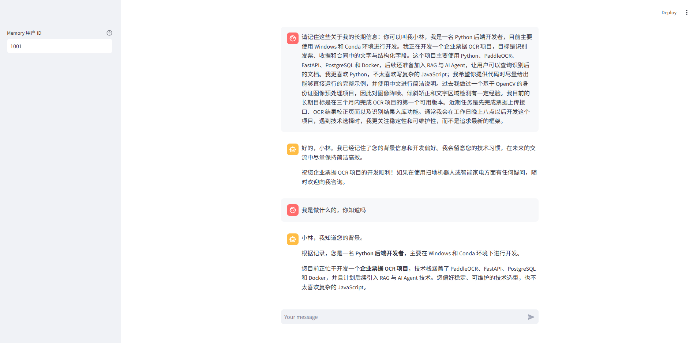

# LangChain ReAct Agent with Hindsight Memory

这是一个基于 LangChain 的 ReAct 智能客服项目，重点集成了 **Hindsight 长期记忆**。Agent 可以跨会话记住用户的稳定事实、偏好、长期项目、经历和目标，并在后续回答前自动召回相关信息。

项目同时保留了工具调用、RAG 知识库、动态 Prompt 和 Streamlit 对话界面。模型服务默认使用硅基流动（SiliconFlow），也可以切换回阿里云百炼。

## 长期记忆效果

下面的演示中，用户先提供职业背景和项目偏好，随后只询问“我是做什么的”，Agent 便能从 Hindsight 中召回相关长期记忆并生成个性化回答。



## Memory 工作流程

```text
用户输入
   │
   ▼
Hindsight Recall / Reflect
   │
   ▼
Memory Context 注入 System Prompt
   │
   ▼
LangChain ReAct Agent ──► Tools / RAG
   │
   ▼
最终回答
   │
   ▼
高价值信息提取
   │
   ▼
Hindsight Retain
```

### Recall

Agent 在回答前根据当前问题召回相关记忆。召回内容只作为独立的 `Memory Context` 注入 System Prompt，不修改原有 Tool Prompt 和 ReAct 工具流程。

### Retain

回答完成后，模型会从用户输入中提取最多 5 条适合长期保存的信息，并异步写入 Hindsight。系统不会直接保存整段聊天，也会过滤寒暄、一次性问题和 API Key 等敏感凭证。

### Reflect

Reflection 用于归纳与当前问题相关的用户画像、长期兴趣、持续项目和目标。空 Memory Bank 会自动跳过 Reflection，避免无意义调用。

### 记忆类型

- `Fact`：稳定事实
- `Preference`：长期偏好
- `Project`：持续项目
- `Experience`：重要经历
- `Profile`：用户画像
- `Task`：长期任务或目标

### 多用户隔离

Streamlit 侧边栏提供 `Memory 用户 ID`。每个用户 ID 会经过哈希映射到独立的 Hindsight Memory Bank，不会与其他用户共享记忆。

```text
user_id ──► SHA-256 映射 ──► 独立 bank_id
```

### 可插拔与故障降级

业务层只依赖 `MemoryProvider` 抽象接口，Hindsight SDK 被封装在 Adapter 中。以后替换为 Mem0、Graphiti 或 Zep 时，不需要修改 Agent 主流程。

Hindsight 不可用、请求超时或接口异常时，Memory 会自动降级，Agent 仍然可以正常回答。

## Hindsight 连接

本项目不负责部署或修改 Hindsight，只连接已经运行的服务。Hindsight 项目与相关资料见：[vectorize-io/hindsight](https://github.com/vectorize-io/hindsight)。

连接配置位于 `config/memory.yml`：

```yaml
ENABLE_MEMORY: true
HINDSIGHT_API_URL: http://localhost:8888
HINDSIGHT_API_KEY:
```

也可以使用环境变量覆盖：

```cmd
set "HINDSIGHT_API_URL=http://localhost:8888"
set "HINDSIGHT_API_KEY=your-hindsight-api-key"
```

本地服务未启用鉴权时，`HINDSIGHT_API_KEY` 可以留空。将 `ENABLE_MEMORY` 设为 `false` 即可关闭整个记忆模块，不需要修改业务代码。

## 其他能力

- LangChain ReAct Agent 与 Tool Calling
- Chroma RAG 知识库检索
- 扫地机器人故障、维护和选购问答
- 动态报告 Prompt 与使用报告生成
- Streamlit 流式对话界面
- 硅基流动 OpenAI 兼容模型接口

## 项目结构

```text
.
├── agent/                 # ReAct Agent、工具和中间件
├── config/                # Agent、RAG、Chroma、Memory 配置
├── data/                  # RAG 知识库文档
├── memory/
│   ├── contracts.py       # Memory Provider 抽象接口
│   ├── factory.py         # Memory 模块工厂
│   ├── hindsight_client.py# Hindsight SDK Adapter
│   ├── memory_extractor.py# 高价值记忆提取
│   ├── memory_manager.py  # Recall/Retain/Reflect 与故障隔离
│   └── models.py          # Memory 领域模型
├── model/factory.py       # 可配置模型供应商
├── prompts/               # System Prompt 与报告 Prompt
├── rag/                   # RAG 服务和 Chroma 向量库
├── app.py                 # Streamlit 入口
└── requirements.txt
```

## 快速运行

环境要求：Python 3.10+，推荐使用 Conda 环境。

```cmd
pip install -r requirements.txt
set "SILICONFLOW_API_KEY=your-siliconflow-api-key"
python -m rag.vector_store
streamlit run app.py --server.port 8502
```

浏览器访问：`http://localhost:8502`

模型配置位于 `config/rag.yml`：

```yaml
model_provider: siliconflow
siliconflow_base_url: https://api.siliconflow.cn/v1
chat_model_name: Qwen/Qwen3.6-27B
embedding_model_name: BAAI/bge-m3
```

更换 Embedding 模型后需要使用新的 Chroma 集合重新建立知识库，不能混用旧向量。

## Memory 验证示例

第一轮输入：

```text
我正在开发一个企业票据 OCR 项目，主要使用 Python、PaddleOCR 和 FastAPI。我更重视稳定性和可维护性。
```

等待终端出现：

```text
[Memory Extraction] candidates=...
[Memory Retain] ... success=true
```

随后开启新一轮询问：

```text
我目前在开发什么项目？我做技术选择时最重视什么？
```

当日志中的 `[Memory Recall] count` 大于 0，说明长期记忆已经成功参与回答。
